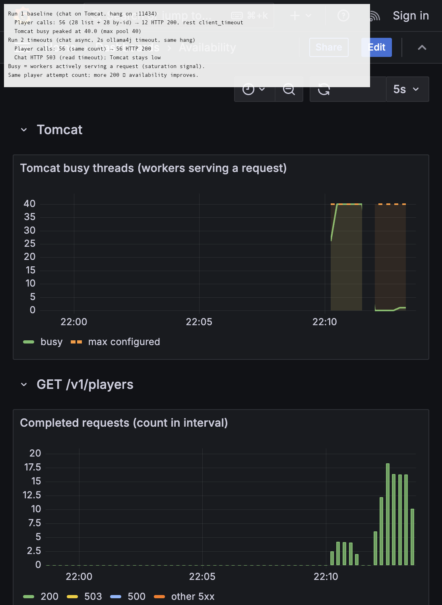

# Player service demo

Run this once. Later blocks assume this shell.

```bash
export JAVA_HOME="/opt/homebrew/opt/openjdk@17"
export PATH="$JAVA_HOME/bin:$PATH"
cd ~/git/player-service-java
```

Terminal 1 stays on `mvn spring-boot:run`. Paste the other blocks in terminal 2, unless a block says to leave it running.

---

## 1. Currently on main

`main` is the stock service, plus two local commits: drop the duplicate `spring-boot-starter-data-jpa` so Maven 3.10 can build, and bump `ollama4j` to 1.0.100 so `list-models` can read the `capabilities` field.

```bash
git branch --show-current
git log -3 --oneline
git status -sb
```

Terminal 1:

```bash
mvn spring-boot:run
```

---

## 2. Repo architecture and APIs

One Spring Boot process on port 8080. Player reads and chat calls share the Tomcat worker pool. H2 is in memory. Ollama is a separate process on port 11434.

```text
PlayerController  -> PlayerService -> PlayerRepository -> H2
ChatController    -> ChatClientService -> OllamaAPI -> http://127.0.0.1:11434
```

```bash
find src/main/java -name '*.java' | sort
```

| API | What it does |
|-----|----------------|
| `GET /v1/players` | Every player in H2 |
| `GET /v1/players/{id}` | One player. Sleeps 0–2s on purpose |
| `GET /v1/chat/list-models` | Models registered in Ollama |
| `POST /v1/chat` | Asks tinyllama for a haiku |

```bash
colima start
docker start ollama
until curl -sf http://127.0.0.1:11434/api/tags >/dev/null; do sleep 2; done
curl -s http://127.0.0.1:11434/api/tags | grep -i tinyllama || docker exec ollama ollama pull tinyllama
```

```bash
curl -s -o /dev/null -w "players %{http_code}\n" localhost:8080/v1/players
curl -s -o /dev/null -w "player %{http_code}\n" localhost:8080/v1/players/aardsda01
curl -si localhost:8080/v1/players/no-such-player | head -n 1
curl -s -w "\nmodels %{http_code}\n" localhost:8080/v1/chat/list-models
```

A missing id is 404 with an empty body. `list-models` is 200 when Ollama is up.

---

## 3. Problem

### No observability when the pool is saturated

On `main` there is no Prometheus scrape, no Grafana dashboard, and no in-app SLI. HTTP metrics exist only if you add Actuator and wire a stack yourself.

When chat holds every Tomcat worker, new player calls may never get a response line before the client gives up. Without metrics on a separate management port, even a scrape of `/actuator/prometheus` on **8080** can stall behind the same workers. You cannot see **Tomcat busy → 40**, you cannot stack **200 / 503 / 500** by API, and you cannot tell **client timeouts** (no HTTP status) from a fast **503** from the app.

The branch adds Actuator on **8081**, Prometheus, Grafana, and ramp scripts that label outcomes (`http_200`, `http_503`, `client_timeout`).

### Database failure is returned as 404

Still on `main`. The `sed` ranges in this section are main's line numbers.

`getPlayerById` catches every exception and returns empty. The controller answers 404 for that empty result. The 0–2s sleep stays; it is the simulated delay. File: `src/main/java/com/app/playerservicejava/service/PlayerService.java`.

```bash
sed -n '27,39p' src/main/java/com/app/playerservicejava/service/PlayerService.java
sed -n '28,36p' src/main/java/com/app/playerservicejava/controller/PlayerController.java
```

`aardsda01` is a real id. Drop `PLAYERS`, then request that id. The app log says `Table "PLAYERS" not found`. The HTTP status is still 404 with an empty body.

```bash
jsession=$(curl -s http://localhost:8080/h2-console/ | sed -n 's/.*jsessionid=\([a-f0-9]*\).*/\1/p')
curl -s -o /dev/null "http://localhost:8080/h2-console/login.jsp?jsessionid=$jsession"
curl -s -o /dev/null \
  --data-urlencode 'language=en' \
  --data-urlencode 'setting=Generic H2 (Embedded)' \
  --data-urlencode 'name=Generic H2 (Embedded)' \
  --data-urlencode 'driver=org.h2.Driver' \
  --data-urlencode 'url=jdbc:h2:mem:playerdb' \
  --data-urlencode 'user=sa' \
  --data-urlencode 'password=' \
  "http://localhost:8080/h2-console/login.do?jsessionid=$jsession"
curl -s -o /dev/null \
  --data-urlencode 'sql=DROP TABLE PLAYERS' \
  "http://localhost:8080/h2-console/query.do?jsessionid=$jsession"
curl -si localhost:8080/v1/players/aardsda01 | head -n 1
```

In terminal 1, Ctrl-C and start the app again so the table is loaded:

```bash
mvn spring-boot:run
```

### A stuck chat call holds a Tomcat worker for 120s

Chat runs on the request thread. `ChatClientConfiguration` sets one timeout, 120 seconds, and no connect timeout. Tomcat's default max is 200 workers. Each in-flight chat call occupies one worker until that timeout.

```bash
sed -n '25,28p' src/main/java/com/app/playerservicejava/config/ChatClientConfiguration.java
```

Stopping Ollama is a fast 503. Nothing accepts the connection, so the worker is released at once.

```bash
docker stop ollama
curl -s -m 5 -w "refused %{http_code} in %{time_total}s\n" localhost:8080/v1/chat/list-models
```

For the ramp test, scripts use a **hang peer** instead of `nc`: bind `127.0.0.1:11434`, accept TCP, never send an HTTP body. That mimics a connected model that never responds.

When enough chat calls are in flight on Tomcat threads, player lookups have no worker and do not finish within the load script's deadline. H2 can be healthy the whole time. The branch pins Tomcat to **40** threads so a laptop can reproduce saturation quickly.

---

## 4. Monitoring and availability branch

```bash
git checkout craft-demo/availability
git branch --show-current
git log --oneline main..HEAD
git diff --stat main...HEAD
```

Ctrl-C the app in terminal 1. Build once:

```bash
mvn -DskipTests package
```

### Monitoring and dashboard

**Stack.** Prometheus scrapes **`host.docker.internal:8081`** (management port). API traffic stays on **8080**.

```bash
sh craft-demo/observability/up.sh
```

Open http://localhost:3000/d/availability/availability

| Panel | What it shows |
|-------|----------------|
| Request counts | `increase(...)` stacked **200 / 503 / 500** per API (not req/s) |
| Tomcat busy threads | Saturation signal; dashed line at **40** |
| (No latency) | Pool **503** is fast; hung baseline chat may not complete, so latency is misleading |

**In-app SLI and probes.** Files: `reliability/SliRecordingFilter.java`, `reliability/SliTracker.java`, `reliability/ServiceInfoContributor.java`, `resources/application.yml`.

- `SliTracker` publishes player availability (player HTTP below 500). Chat is tracked but not in that ratio.
- Liveness: `livenessState` only.
- Readiness: `readinessState` + H2 (Ollama omitted).
- `/v1/reliability/mode` shows active profile (`baseline` vs `timeouts`).

Terminal 1 (example hardened profile):

```bash
java -jar target/player-service-java-0.0.1-SNAPSHOT.jar --spring.profiles.active=timeouts
```

```bash
curl -s localhost:8081/actuator/health/liveness | python3 -m json.tool
curl -s localhost:8081/actuator/health/readiness | python3 -m json.tool
curl -s localhost:8081/actuator/info | python3 -m json.tool
curl -s localhost:8081/actuator/prometheus | head
curl -s localhost:8080/v1/reliability/mode | python3 -m json.tool
curl -s -X POST localhost:8080/v1/reliability/sli/reset >/dev/null
curl -s -o /dev/null localhost:8080/v1/players/aardsda01
curl -s localhost:8080/v1/reliability/sli | python3 -m json.tool
```

When all **8080** workers are busy, health and Prometheus on **8081** still answer. That is what makes the dashboard usable during baseline saturation.

### Availability fix (baseline vs timeouts only)

Comparison is two profiles only. No retry, no circuit breaker, no extra stage YAML files.

| Profile | Chat execution | Ollama timeouts | Player under hang load |
|---------|----------------|-----------------|-------------------------|
| **baseline** (default) | Tomcat request thread | ollama4j **120s** request timeout | **client_timeout** once Tomcat is full |
| **timeouts** (`application-timeouts.yml`) | 8 `chat-exec` threads, queue 0 | ollama4j **2s** request timeout | **http_200**; chat **503** (timeout on hang peer) |

**Database failures are 500.** `PlayerService` no longer swallows `DataAccessException`. Missing id stays **404**.

```bash
sed -n '36,49p' src/main/java/com/app/playerservicejava/service/PlayerService.java
sed -n '19,26p' src/main/java/com/app/playerservicejava/controller/PlayerExceptionHandler.java
mvn -Dtest=PlayerErrorStatusTest test
```

**Chat leaves Tomcat when `async-enabled` is true.** `ChatController` returns a `Callable`; `ChatAsyncConfig` runs on `chat-exec-*`.

```bash
sed -n '45,51p' src/main/java/com/app/playerservicejava/controller/chat/ChatController.java
sed -n '20,30p' src/main/java/com/app/playerservicejava/chat/ChatAsyncConfig.java
cat src/main/resources/application-timeouts.yml
```

**Shorter chat timeout via ollama4j.** `ChatClientConfiguration` sets `OllamaAPI.setRequestTimeoutSeconds` from `app.chat.read-timeout-ms`.

```bash
sed -n '17,28p' src/main/java/com/app/playerservicejava/config/ChatClientConfiguration.java
cat src/main/resources/application-timeouts.yml
```

### Ramp load test (capture this data)

Hang simulation: `docker stop ollama`, then the script starts **`hang_server`** on `127.0.0.1:11434` (accept, never reply). Every **5s**, add **6** chat calls (`list-models` + `POST /v1/chat`) and **2** player calls (list + by-id). Outcomes are in JSON as **`outcome`**, not raw HTTP `0`.

Watch Grafana while running. After both runs, see `craft-demo/results/dashboard/README.md` and `ramp-comparison.md`.

```bash
python3 scripts/ramp_load_test.py baseline
python3 scripts/ramp_load_test.py timeouts
```

Expected shape:

| Signal | baseline saturated | timeouts |
|--------|-------------------|----------|
| Tomcat busy (Grafana) | → **40** | stays low |
| Player ramp JSON | **client_timeout** after pool fills | **http_200** |
| Chat ramp JSON | **client_timeout** (no HTTP within client deadline) | **http_503** (2s read timeout on hang peer) |

### Grafana screenshots (checked in)

After both ramp runs, open the dashboard (last **15 minutes**), capture a PNG, then overlay the ramp totals:

```bash
# Save browser screenshot to:
# craft-demo/results/dashboard/grafana-ramp-raw.png
python3 scripts/annotate_ramp_screenshot.py
```

| File | Purpose |
|------|---------|
| [`grafana-ramp-raw.png`](results/dashboard/grafana-ramp-raw.png) | Dashboard during/after ramp (Prometheus data) |
| [`grafana-ramp-annotated.png`](results/dashboard/grafana-ramp-annotated.png) | Same view + baseline vs timeouts summary |



---

## 5. Beyond this process

The numbers above are one JVM. A readiness probe on that single process does not raise them.

### Readiness

Liveness answers "restart this process?" It stays "the process is up." A stuck chat thread is not a dead process. Failing liveness on that would kill the JVM and drop player calls that were still running.

Readiness answers "send this process traffic?" Here it is H2, not Ollama. With the app up and Ollama stopped, readiness on **8081** stays **UP** and `list-models` on **8080** is **503**. Player lookups still return **200**. That is the point: a dead model must not take player traffic off the instance.

```bash
docker stop ollama
curl -s localhost:8081/actuator/health/readiness | python3 -m json.tool
curl -s -m 5 -o /dev/null -w "models %{http_code}\n" localhost:8080/v1/chat/list-models
curl -s -o /dev/null -w "player %{http_code}\n" localhost:8080/v1/players/aardsda01
docker start ollama
```

Readiness improves availability only when some other instance can take the request. One replica: failing readiness means the only copy gets no traffic, so availability goes to 0 until it passes again. Several replicas behind a load balancer: an instance whose database is down is removed, and the others keep serving players. Putting Ollama on that check would remove every instance during a model outage and player availability would fall.

### Other changes

| Change | What it improves | In this demo |
|--------|------------------|--------------|
| Readiness is H2, not Ollama | A dead model does not remove player traffic from this instance | **Show.** The curls above. |
| A second process | Killing one JVM leaves the other returning 200 | **Show.** Two ports, no new code. |
| Caller deadline | Ramp script labels **`client_timeout`** when the app never returns HTTP in time | **Show.** `ramp_load_test.py`. |
| Graceful shutdown | In-flight player calls finish after the process is marked not ready | Say it. The 0–2s sleep would make one request visible. |
| Rollout keeps one ready replica | A deploy does not take down the last healthy copy | Say it. Needs more than one machine or a cluster. |
| Player API and chat API as two deployments | A full chat pool cannot sit in the player process | Say it. Async chat pool already splits work inside one JVM. |
| Database that outlives the process | Restart does not drop the only copy of the data | Say it. `schema.sql` reloads players on startup. |
| More Tomcat threads | More room before the pool is full | Do not show. A 120s chat call still occupies one worker on baseline. |
| Prometheus / Grafana / SLI | See busy threads and completed status codes under load | **Show.** Section 4 dashboard and ramp JSON. |

Second process. Terminal 1 is already on **8080** (management on **8081**). Terminal 2 starts another copy on **8082** (its management port will be **8083** unless you override).

```bash
java -jar target/player-service-java-0.0.1-SNAPSHOT.jar --server.port=8082 --spring.profiles.active=timeouts
```

```bash
curl -s -o /dev/null -w "8080 %{http_code}\n" localhost:8080/v1/players/aardsda01
curl -s -o /dev/null -w "8082 %{http_code}\n" localhost:8082/v1/players/aardsda01
lsof -tiTCP:8080 -sTCP:LISTEN | xargs kill
curl -s -m 5 -o /dev/null -w "8080 after stop %{http_code}\n" localhost:8080/v1/players/aardsda01
curl -s -o /dev/null -w "8082 %{http_code}\n" localhost:8082/v1/players/aardsda01
```

`8080 after stop` fails. `8082` is 200. That is the availability gain from a second instance. Readiness is what tells a load balancer to make that same choice. On one process, failing readiness only stops traffic to the only copy.
