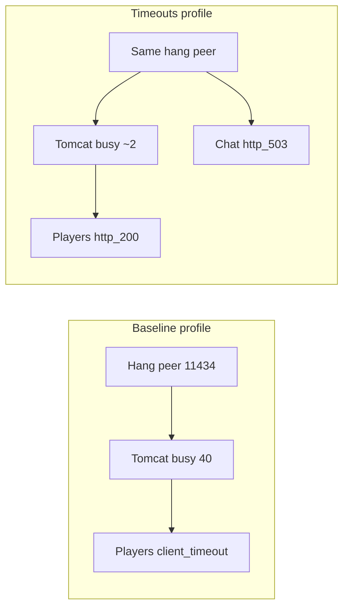

# Presenter scorecard (from ramp JSON)

Use this **instead of** waiting on Grafana during the talk. Numbers are from checked-in `ramp-baseline.json` / `ramp-timeouts.json`.

Screenshots (frozen Grafana): [`screenshots/`](screenshots/) — see README.

## Player API — before vs after

| Player endpoint | **Before (baseline)** | **After (timeouts)** |
|-----------------|----------------------|----------------------|
| `GET /v1/players` | client_timeout: **22**; http_200: **6** | http_200: **28** |
| `GET /v1/players/{id}` | client_timeout: **22**; http_200: **6** | http_200: **28** |

| **Player totals** | **12** `http_200`, **44** `client_timeout` (of 56) | **56** `http_200`, **0** `client_timeout` (of 56) |

## Chat API (context)

| Chat endpoint | **Before (baseline)** | **After (timeouts)** |
|---------------|----------------------|----------------------|
| `GET /v1/chat/list-models` | client_timeout: **78**; no_http_response: **6** | http_503: **84** |
| `POST /v1/chat` | client_timeout: **78**; no_http_response: **6** | http_503: **84** |

## Pool saturation

| Signal | **Before** | **After** |
|--------|------------|-----------|
| Tomcat busy (peak) | **40** / 40 | **2** / 40 |

## Story in one sentence

**Before:** pool fills → **player APIs** stop finishing → load script records `client_timeout`. **After:** chat returns **503** quickly on a side pool → Tomcat stays idle → **both player APIs** finish **http_200**.

## Mermaid (optional slide)



## Regenerate

```bash
python3 scripts/ramp_load_test.py baseline
python3 scripts/ramp_load_test.py timeouts
python3 scripts/render_ramp_scorecard.py
sh scripts/capture_grafana_screenshots.sh
```
